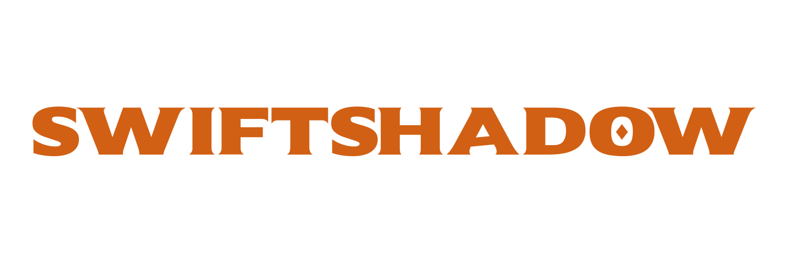

<p align="center">
  
</p>

<p align="center">
  <strong>Lightweight, configurable proxy rotation for Python.</strong>
  <br />
  Simplify proxy management for web scraping, data collection, and automation.
</p>

<p align="center">
  <a href="https://pypi.org/project/swiftshadow/">
    
  </a>
  <a href="https://pypi.org/project/swiftshadow/">
    
  </a>
  <a href="https://img.shields.io/pypi/dm/swiftshadow">
    
  </a>
  <a href="https://github.com/sachin-sankar/swiftshadow/releases">
    
  </a>
  <a href="https://github.com/sachin-sankar/swiftshadow/blob/main/LICENSE">
    
  </a>
</p>

> [!WARNING]
> **Breaking changes in v2.0.0 and later**
>
> Upgrading from v1.2.1 or earlier requires attention: v2.0.0 introduced breaking changes. Review the [documentation](https://sachin-sankar.github.io/swiftshadow/) before upgrading to understand the migration requirements. If you encounter an issue, check the documentation and migration guidance before opening a bug report.

## Overview

**Swiftshadow** is a lightweight Python library for retrieving and rotating HTTP proxies. It provides a simple interface for obtaining proxies, filtering them by country and protocol, and configuring proxy selection to suit your workflow.

Whether you're building a small scraping script or a larger data collection pipeline, Swiftshadow helps simplify proxy management without adding unnecessary dependencies.

## Features

- **Quick proxy retrieval** — Get a proxy with a single function call.
- **Automatic rotation** — Switch proxies when your workflow requires a different endpoint.
- **Configurable filtering** — Select proxies by country and protocol.
- **Caching** — Reuse cached proxy data to reduce repeated retrieval overhead.
- **Lightweight** — Only one third-party dependency: `requests`.
- **Simple API** — Start with `QuickProxy` or use `ProxyInterface` for more control.

## Installation

Install Swiftshadow from PyPI:

```bash
pip install swiftshadow
uv add swiftshadow
```

## Quick start

### Get a proxy

Retrieve a proxy with `QuickProxy`:

```python
from swiftshadow import QuickProxy

proxy = QuickProxy()
print(proxy)
# Example: http://<ip>:<port>
```

### Filter proxies

Use `ProxyInterface` when you need to configure proxy selection:

```python
from swiftshadow.classes import ProxyInterface

proxy_pool = ProxyInterface(
    countries=["US"],
    protocol="https",
)

proxy = proxy_pool.get()
print(proxy.as_string())
# Example: https://<ip>:<port>
```

These examples illustrate the basic API. See the documentation for supported configuration options, proxy formats, and rotation behavior.

## Documentation

**[Read the full documentation →](https://sachin-sankar.github.io/swiftshadow/)**

Explore configuration options, API references, and advanced usage.

## Contributing

Contributions, bug reports, and feature suggestions are welcome.

1. Check the existing [issues](https://github.com/sachin-sankar/swiftshadow/issues).
2. Open an issue to discuss significant changes.
3. Submit a pull request with a clear description of your changes.

Please review the project's documentation before reporting issues related to configuration or version compatibility.

## License

Swiftshadow is distributed under the [GPL 3.0 License](https://github.com/sachin-sankar/swiftshadow/blob/main/LICENSE).

